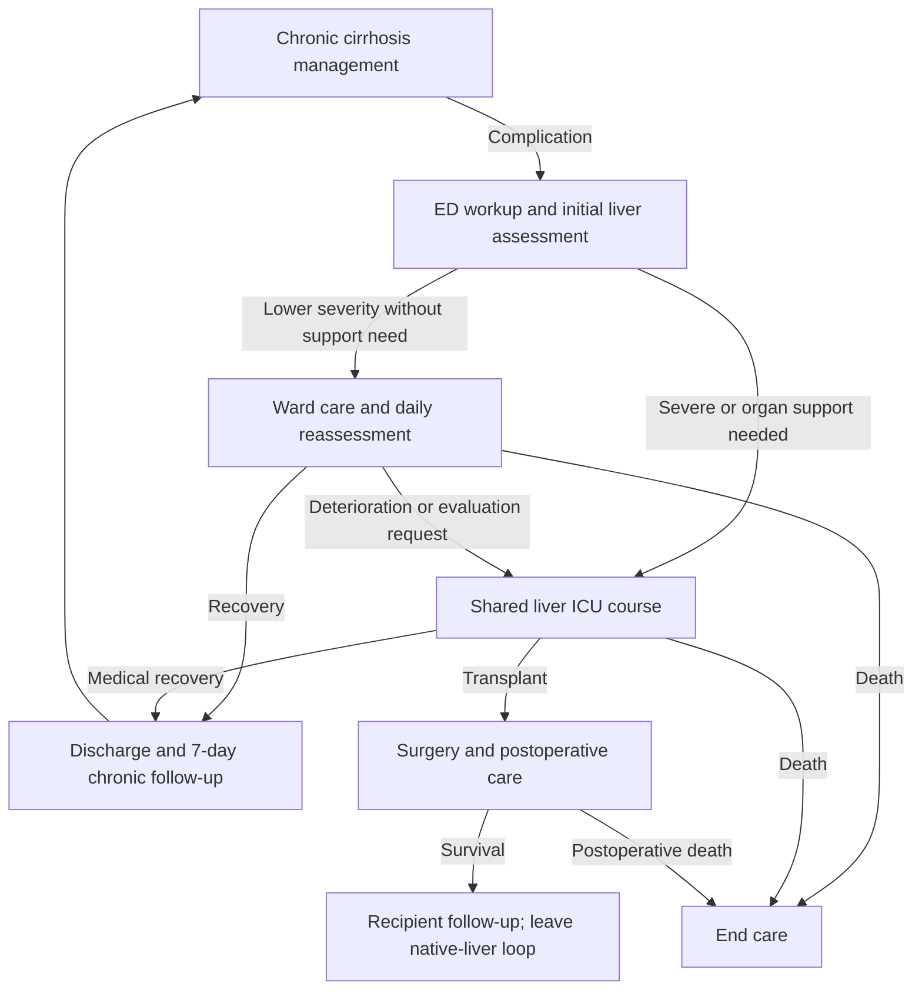

# Cirrhosis decompensation and return to chronic care

The existing mixed-cause [`cirrhosis.json`](../synthea/modules/cirrhosis.json) now connects its
complication branch to shared liver assessment and [ICU/transplant care](LIVER_CARE.md). Its
population-onset logic and management probabilities remain unchanged: after each 4–10 month
delay, follow-up is 66%, decompensation 10%, delayed native-liver death 4%, and continued management
20%. These are synthetic branch probabilities, not annual clinical rates.



## Cause and episode identity

The parent still represents mixed alcohol, viral, and other cirrhosis. The bridge defaults
`liver_cirrhosis_etiology` to `unspecified` and uses the generic `cirrhosis` model profile. Only an
explicit value of `alcohol` selects `alcohol_cirrhosis`; an old toxin episode or unspecified cause
cannot relabel chronic disease as alcohol-related. The generic profile currently copies the
illustrative chronic coefficients. It does not establish equivalence between causes.

The bridge requires active native-liver cirrhosis and no recipient status. It waits if another
shared liver episode or care course is active, and it does not take ownership of pre-existing
cirrhosis or medication records created by another parent. Active native cirrhosis remains one
condition across recovery and recurrence. Acute decompensation and organ conditions are separate
episode-owned records. Chronic disease uses the shared decompensation/ACLF phenotype and is not
labeled de novo acute liver failure.

## Acute assessment and handoff

[`scripts/liver_cirrhosis.py`](../scripts/liver_cirrhosis.py) compiles three helpers:
`liver/cirrhosis_decompensation`, `liver/cirrhosis_stop_chronic`, and
`liver/cirrhosis_resume_chronic`. Parameters live in `cirrhosis_integration` in
[`liver_model.json`](../synthea/liver_model.json).

An ED encounter includes a one-hour workup before the initial nine-lab assessment. Initial
severity is drawn uniformly from 0.2–1.0. Severity at least 0.75, or a modeled airway, renal, or
circulatory support requirement, sends the patient to ICU. Other patients enter ward care with
daily reassessment. These thresholds and entry probabilities are demonstration assumptions.

Ward care starts a recovery trajectory, with daily outcomes that can change it to deterioration,
request ICU/transplant evaluation, or cause death. Resolution ends the acute episode and permits
discharge. Severity and support requirements are rechecked daily. ICU handoff continues the same
episode, severity, and daily laboratory clock; it does not redraw severity or restart day zero.
The explicit ED delay also prevents Synthea's default duration for a zero-length ED encounter
from overlapping the following inpatient encounter. No hospital-to-hospital transfer is created.

## Chronic treatment and terminal outcomes

The parent tracks ownership of its spironolactone, furosemide, propranolol, lactulose, and low-salt
diet plan. Existing active prescriptions from other modules are not adopted or stopped. The
bridge holds its own chronic orders before ICU entry. After medical recovery, a seven-day
follow-up restores missing chronic orders and returns to the normal management delay; recovery
does not erase native cirrhosis. Non-ICU care retains chronic treatment during the acute episode.
This is coarse synthetic medication reconciliation, not individualized treatment or dosing.

Transplant surgery closes native cirrhosis, retains its history, and creates persistent recipient
status and immunosuppression through the shared course. The parent terminates after recipient
follow-up and cannot restart the native-cirrhosis management loop. Owned chronic prescriptions
also stop on death. A preselected chronic disease-death branch now uses a cancellable 1–12 month
delay followed by a status check: a graft received during that delay prevents native-liver death
from being recorded afterward.

## Population and calibration limits

The bridge runs for cirrhosis complications in normal population generation. It does not add
alcohol-use history, abstinence/relapse, etiology-specific incidence, or toxin exposure and
treatment entry. These remain fuller work under issues #6/#7. Chronic symptoms and medication
decisions remain simplified; this is not a complete longitudinal hepatology model.

The existing hospital cohort is not subjected to a second 25% referral filter. The separate
regional referral helper still implements the user-assumed 25% DC-metro share. With multiple
facilities enabled, this bridge does not enforce MGUH assignment or create transfers.

The [calibration runner](LIVER_CALIBRATION.md) now has an integrated cirrhosis mode that preserves
this pathway's entry severity and ward-to-ICU selection. The user accepted approximately 21%
transplantation after the completed training fit produced 20.74%; the original reference cohort
retains its separate 25% target. The cirrhosis factor acts only in native-liver ICU care before
evaluation. Incidence, background disease effects, recurrence, and annual volume remain
uncalibrated. Keep index entrants separate from repeat admissions when measuring this target.

## Exports and verification

No clinical schema or stock JAR changes are required. Acute encounters, conditions, treatments,
daily labs, surgery, and follow-up use the existing CSV/Parquet tables. The repository's note
template now includes precise encounter-start headers so same-day ED and inpatient notes match
their respective encounters. Date-only legacy notes retain heuristic matching; encounters with
identical start timestamps remain ambiguous. See the [notes schema](DATA_DICTIONARY.md#43-clinical-notes-notes--notes_llm).

```bash
uv run python scripts/build_liver_modules.py --check
uv run python scripts/tests/run_cirrhosis_integration_tests.py
uv run python scripts/tests/cirrhosis_export_smoke.py
```

The real-engine integration suite covers 16 complete parent journeys, including recurrence,
medication/condition ownership, routine follow-up, and delayed-death cancellation. Six generator
scenarios verify CSV/Parquet equality, daily lab timing across handoff, encounter intervals,
chronic treatment reconciliation, and same-day note linkage. Test-only probabilities force
branches in temporary module copies; production modules expose no forced-outcome option.
