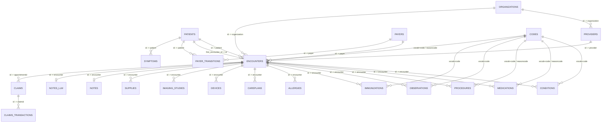

# Synthetic MGUH Data Dictionary & Query Guide

This document provides the complete schema reference, entity-relationship model, code normalization & OHDSI Athena crosswalk guide, and SQL/Python query cookbook for the **Synthetic MGUH** Parquet dataset (`output/parquet/*.parquet`).

---

## Table of Contents

1. [Dataset Architecture & Entity-Relationship Model](#1-dataset-architecture--entity-relationship-model)
2. [EHR Launch Date (`2010-01-01`) & Historical Record Semantics](#2-ehr-launch-date-2010-01-01--historical-record-semantics)
3. [Code Normalization & OHDSI Athena Crosswalk (`codes.parquet`)](#3-code-normalization--ohdsi-athena-crosswalk-codesparquet)
4. [Column-by-Column Schema Reference (All 22 Tables)](#4-column-by-column-schema-reference-all-22-tables)
   - [4.1 Demographics, Providers & Payers](#41-demographics-providers--payers)
   - [4.2 Clinical Encounters & Care Records](#42-clinical-encounters--care-records)
   - [4.3 Clinical Notes (`notes` & `notes_llm`)](#43-clinical-notes-notes--notes_llm)
   - [4.4 Financial & Billing (`claims` & `claims_transactions`)](#44-financial--billing-claims--claims_transactions)
   - [4.5 Vocabulary & Crosswalk (`codes`)](#45-vocabulary--crosswalk-codes)
5. [Clinical Notes & LLM Transformation Reference](#5-clinical-notes--llm-transformation-reference)
6. [SQL & Python Query Cookbook](#6-sql--python-query-cookbook)

---

## 1. Dataset Architecture & Entity-Relationship Model

All tables are stored as ZSTD-compressed Parquet files clustered by patient and chronological date for fast predicate pushdown in DuckDB, Polars, Pandas, R, and Databricks Unity Catalog.



### Summary of All 22 Parquet Tables

| Table | Domain | Primary Key | Primary Foreign Keys | Rows per 10k Living Patients* |
|---|---|---|---|---:|
| `patients.parquet` | Demographics | `id` | `first_encounter_id` → `encounters.id` | ~13,981 |
| `organizations.parquet` | Directory | `id` | — | 10 |
| `providers.parquet` | Directory | `id` | `organization` → `organizations.id` | 10+ |
| `payers.parquet` | Insurance | `id` | — | 10 |
| `payer_transitions.parquet` | Insurance | — | `patient`, `payer`, `secondary_payer` | ~169,826 |
| `encounters.parquet` | Clinical | `id` | `patient`, `organization`, `provider`, `payer` | ~738,519 |
| `conditions.parquet` | Clinical | — | `patient`, `encounter` | ~663,829 |
| `medications.parquet` | Clinical | — | `patient`, `encounter`, `payer` | ~913,929 |
| `procedures.parquet` | Clinical | — | `patient`, `encounter` | ~2,280,891 |
| `observations.parquet` | Clinical | — | `patient`, `encounter` | ~9,313,834 |
| `immunizations.parquet` | Clinical | — | `patient`, `encounter` | ~252,410 |
| `allergies.parquet` | Clinical | — | `patient`, `encounter` | ~12,535 |
| `careplans.parquet` | Clinical | `id` | `patient`, `encounter` | ~57,335 |
| `devices.parquet` | Clinical | — | `patient`, `encounter` | ~105,344 |
| `imaging_studies.parquet` | Clinical | `id` | `patient`, `encounter` | ~58,707 |
| `supplies.parquet` | Clinical | — | `patient`, `encounter` | ~323,955 |
| `symptoms.parquet` | Clinical | — | `patient` | ~1,513,637 |
| `notes.parquet` | Clinical Notes | `(patient, encounter)` | `patient`, `encounter` | ~738,513 |
| `notes_llm.parquet` | Clinical Notes | `(patient, encounter)` | `patient`, `encounter` | ~738,513 |
| `claims.parquet` | Financial | `id` | `patientid`, `providerid`, `appointmentid` | ~1,314,167 |
| `claims_transactions.parquet` | Financial | `id` | `claimid`, `patientid`, `appointmentid`, `providerid` | ~11,758,557 |
| `codes.parquet` | Vocabulary | `(vocab, code)` | — | ~1,654 |

*\*A target of 10,000 living patients (`--total 10000`) includes ~3,981 deceased patients generated over the simulation window (`13,981` total patients).*

---

## 2. EHR Launch Date (`2010-01-01`) & Historical Record Semantics

To simulate a realistic hospital EHR system launched on **`2010-01-01`** (configurable via `--start` in `3_convert_to_parquet.py`), the pipeline applies two distinct rules to pre-2010 records:

1. **Operational / Event Tables are Filtered to `>= 2010-01-01`**:
   - `encounters` (`stop >= 2010-01-01`)
   - `observations` (`date >= 2010-01-01`)
   - `procedures` (`start >= 2010-01-01`)
   - `imaging_studies` (`date >= 2010-01-01`)
   - `supplies` (`date >= 2010-01-01`)
   - `payer_transitions` (`start_date >= 2010-01-01`)
   - `claims` (`servicedate >= 2010-01-01`) & `claims_transactions` (`fromdate >= 2010-01-01`)
   - `notes` & `notes_llm` (`date >= 2010-01-01`)
2. **Longitudinal Problem-List / History Tables Retain Pre-2010 Records via `first_encounter_id`**:
   - In a real EHR intake, a patient's pre-existing chronic conditions (e.g., childhood asthma diagnosed in 1998), allergies, immunizations, active medications, careplans, and implanted devices are recorded at their first EHR visit while preserving their historical onset date (`start`).
   - During conversion, `patients.first_encounter_id` is computed as the earliest post-`2010-01-01` encounter for each patient.
   - Any record in `conditions`, `allergies`, `careplans`, `devices`, `medications`, or `immunizations` whose original pre-2010 encounter was trimmed has its `encounter` foreign key reassigned to `patients.first_encounter_id`. This guarantees **zero orphan foreign keys** while preserving full lifetime medical history.

> [!TIP]
> **Distinguishing Historical Intake Conditions from New Visit Diagnoses**
> - **All conditions known for a patient**: Query `conditions` directly (`start` gives the true onset date; `stop IS NULL` indicates an active ongoing condition).
> - **Only diagnoses newly made during post-2010 EHR visits**: Filter `WHERE start >= '2010-01-01'`.

---

## 3. Code Normalization & OHDSI Athena Crosswalk (`codes.parquet`)

By default, `3_convert_to_parquet.py` strips redundant text description columns (`description`, `reasondescription`, `description1`, `description2`, `bodysite_description`, `modality_description`, `sop_description`, `pathology`, and `claims_transactions.notes`) from all clinical and financial tables, reducing Parquet storage by **30–50%**.

All unique medical codes across the entire dataset are normalized into `codes.parquet` (primary key: `(vocab, code)`) and enriched with OHDSI Athena OMOP, ICD-10-CM, and HCPCS mappings via `synthea/athena_code_crosswalk.parquet`.

### How Every Coded Column Joins to `codes.parquet`

> [!IMPORTANT]
> Because some tables store purely numeric SNOMED/RxNorm codes as `BIGINT` while `codes.code` is `VARCHAR` (to accommodate alphanumeric LOINC, DICOM, and HCPCS codes), always cast `BIGINT` code columns to `VARCHAR` when joining:
> `ON c.vocab = 'SNOMED' AND c.code = CAST(t.code AS VARCHAR)`

| Table | Coded Column(s) | Column Type | Target `codes.vocab` | Notes |
|---|---|---|---|---|
| `allergies` | `code` | `BIGINT` | `SNOMED` or `RxNorm` | Matches `allergies.system` (`SNOMED-CT` → `SNOMED`, `RxNorm` → `RxNorm`) |
| `allergies` | `reaction1`, `reaction2` | `BIGINT` | `SNOMED` | Clinical reaction findings |
| `careplans` | `code`, `reasoncode` | `BIGINT` | `SNOMED` | Care plan artifact & indication |
| `claims` | `diagnosis1`..`diagnosis8` | `BIGINT` / `VARCHAR` | `SNOMED` | Encounter diagnosis codes |
| `claims_transactions` | `procedurecode` | `VARCHAR` | `SNOMED`, `CVX`, or `RxNorm` | Billed encounter/procedure/vaccine/drug code |
| `conditions` | `code` | `BIGINT` | `SNOMED` | Disorders, findings, and SDOH situations |
| `devices` | `code` | `BIGINT` | `SNOMED` | Medical devices |
| `encounters` | `code`, `reasoncode` | `BIGINT` | `SNOMED` | Visit type (`code`) and reason for visit (`reasoncode`) |
| `imaging_studies` | `procedure_code`, `bodysite_code` | `BIGINT` | `SNOMED` | Imaging procedure and anatomical site |
| `imaging_studies` | `modality_code` | `VARCHAR` | `DICOM-DCM` | Acquisition modality (`CR`, `CT`, `DX`, `MR`, `US`, `XA`) |
| `imaging_studies` | `sop_code` | `VARCHAR` | `DICOM-SOP` | DICOM SOP Class UID |
| `immunizations` | `code` | `VARCHAR` | `CVX` | CDC CVX vaccine code |
| `medications` | `code` | `BIGINT` | `RxNorm` | Medication product/ingredient |
| `medications` | `reasoncode` | `BIGINT` | `SNOMED` | Diagnosis indication for medication |
| `observations` | `code` | `VARCHAR` | `LOINC` or `SNOMED` | Vital signs, labs, exam findings, and surveys |
| `procedures` | `code`, `reasoncode` | `BIGINT` | `SNOMED` | Clinical procedure and indication |
| `supplies` | `code` | `BIGINT` | `SNOMED` | Medical supply item |
| `symptoms` | `code` | `BIGINT` | `SNOMED` | Underlying condition SNOMED code (normalized from `pathology`) |

### OHDSI Athena Crosswalk Columns in `codes.parquet`

| Column | Type | Coverage | Description |
|---|---|---|---|
| `vocab` | `VARCHAR` | 100% | Source vocabulary (`SNOMED`, `RxNorm`, `LOINC`, `CVX`, `DICOM-DCM`, `DICOM-SOP`, `NUBC`) |
| `code` | `VARCHAR` | 100% | Source concept code as string |
| `description` | `VARCHAR` | 100% | Normalized lowercase human-readable description |
| `omop_concept_id` | `BIGINT` | ~96.4% | Standard OHDSI Athena OMOP v5 `concept_id` |
| `omop_domain_id` | `VARCHAR` | 100% | OMOP domain (`Condition`, `Drug`, `Procedure`, `Measurement`, `Observation`, `Device`, `Spec Anatomic Site`) |
| `icd10cm_code` | `VARCHAR` | **100%** of `Condition` diagnoses | Mapped ICD-10-CM billing/diagnosis code (e.g., `I10`, `E11.9`, `J18.9`, `F31.10`) |
| `icd10cm_description` | `VARCHAR` | **100%** of `Condition` diagnoses | Official ICD-10-CM concept name from OHDSI Athena |
| `hcpcs_code` | `VARCHAR` | Mapped procedures/drugs | Mapped HCPCS Level II code where available in Athena |

---

## 4. Column-by-Column Schema Reference (All 22 Tables)

### 4.1 Demographics, Providers & Payers

#### `patients.parquet`
One row per synthetic patient (both living and deceased).
| Column | Type | Description |
|---|---|---|
| `id` | `VARCHAR` | Primary key (UUID) |
| `birthdate` | `TIMESTAMP WITH TIME ZONE` | Date of birth |
| `deathdate` | `TIMESTAMP WITH TIME ZONE` | Date of death (`NULL` if living) |
| `ssn` | `VARCHAR` | Unique synthetic Social Security Number (`999-XX-XXXX`) |
| `drivers` | `VARCHAR` | Synthetic driver's license number (`NULL` if none) |
| `passport` | `VARCHAR` | Synthetic passport number (`NULL` if none) |
| `prefix`, `first`, `middle`, `last`, `suffix`, `maiden` | `VARCHAR` | Patient name components (no numeric suffixes) |
| `marital` | `VARCHAR` | Marital status (`M`, `S`, `D`, `W`, or `NULL`) |
| `race` | `VARCHAR` | Race (`black`, `white`, `asian`, `native`, `hawaiian`, `other`) |
| `ethnicity` | `VARCHAR` | Ethnicity (`hispanic`, `nonhispanic`) |
| `gender` | `VARCHAR` | Administrative sex (`M`, `F`) |
| `birthplace` | `VARCHAR` | City, state/country of birth |
| `address`, `city`, `state`, `county` | `VARCHAR` | Residential address (Washington, District of Columbia) |
| `fips` | `BIGINT` | County FIPS code (`11001` for DC) |
| `zip` | `BIGINT` | 5-digit ZIP code |
| `lat`, `lon` | `DOUBLE` | Residential latitude and longitude |
| `healthcare_expenses` | `DOUBLE` | Cumulative out-of-pocket healthcare expenses |
| `healthcare_coverage` | `DOUBLE` | Cumulative payer-covered healthcare expenses |
| `income` | `BIGINT` | Annual household income in USD |
| `first_encounter_id` | `VARCHAR` | Foreign key to the patient's earliest post-`2010-01-01` `encounters.id` |

#### `organizations.parquet`
MedStar Health and DC healthcare facilities.
| Column | Type | Description |
|---|---|---|
| `id` | `VARCHAR` | Primary key (UUID) |
| `name` | `VARCHAR` | Facility name (e.g., `MEDSTAR GEORGETOWN UNIVERSITY HOSPITAL`) |
| `address`, `city`, `state` | `VARCHAR` | Street address, city, state (`DC`) |
| `zip` | `BIGINT` | 5-digit ZIP code |
| `lat`, `lon` | `DOUBLE` | Facility coordinates |
| `phone` | `VARCHAR` | Facility phone number |
| `revenue` | `DOUBLE` | Cumulative simulated revenue |
| `utilization` | `DOUBLE` | Total encounter count across batches |
| `npi` | `BIGINT` | 10-digit National Provider Identifier (NPI) |

#### `providers.parquet`
Individual clinicians affiliated with `organizations`.
| Column | Type | Description |
|---|---|---|
| `id` | `VARCHAR` | Primary key (UUID) |
| `organization` | `VARCHAR` | Foreign key → `organizations.id` |
| `name` | `VARCHAR` | Clinician full name |
| `gender` | `VARCHAR` | Clinician gender (`M`, `F`) |
| `speciality` | `VARCHAR` | Clinical specialty (e.g., `GENERAL PRACTICE`) |
| `address`, `city`, `state`, `zip`, `lat`, `lon` | `VARCHAR` / `BIGINT` / `DOUBLE` | Practice location |
| `encounters` | `DOUBLE` | Total encounters performed |
| `procedures` | `DOUBLE` | Total procedures performed |
| `npi` | `BIGINT` | 10-digit National Provider Identifier |

#### `payers.parquet` & `payer_transitions.parquet`
Insurance companies (`Medicare`, `Medicaid`, `Dual Eligible`, commercial payers, and `NO_INSURANCE`) and longitudinal member enrollment history.
- **`payers.parquet`**: `id` (`VARCHAR` PK), `name`, `ownership`, `address`, `city`, `state_headquartered`, `zip`, `phone`, `amount_covered`, `amount_uncovered`, `revenue`, `covered_encounters`, `uncovered_encounters`, `covered_medications`, `uncovered_medications`, `covered_procedures`, `uncovered_procedures`, `covered_immunizations`, `uncovered_immunizations`, `unique_customers`, `qols_avg`, `member_months`.
- **`payer_transitions.parquet`**: `patient` (`VARCHAR` FK → `patients.id`), `memberid` (`VARCHAR`), `start_date` (`TIMESTAMPTZ`), `end_date` (`TIMESTAMPTZ`), `payer` (`VARCHAR` FK → `payers.id`), `secondary_payer` (`VARCHAR` FK → `payers.id`), `plan_ownership` (`VARCHAR`), `owner_name` (`VARCHAR`).

---

### 4.2 Clinical Encounters & Care Records

#### `encounters.parquet`
All patient visits completing on or after `2010-01-01`.
| Column | Type | Description |
|---|---|---|
| `id` | `VARCHAR` | Primary key (UUID) |
| `start`, `stop` | `TIMESTAMP WITH TIME ZONE` | Encounter start and end timestamps |
| `patient` | `VARCHAR` | Foreign key → `patients.id` |
| `organization` | `VARCHAR` | Foreign key → `organizations.id` |
| `provider` | `VARCHAR` | Foreign key → `providers.id` |
| `payer` | `VARCHAR` | Foreign key → `payers.id` |
| `encounterclass` | `VARCHAR` | Setting: `ambulatory`, `outpatient`, `wellness`, `urgentcare`, `emergency`, `inpatient`, `virtual`, `home`, `hospice`, or `snf` |
| `code` | `BIGINT` | Visit type SNOMED code → `codes.parquet` (`vocab = 'SNOMED'`) |
| `base_encounter_cost` | `DOUBLE` | Base encounter charge |
| `total_claim_cost` | `DOUBLE` | Total billed cost for the encounter |
| `payer_coverage` | `DOUBLE` | Amount covered by insurance payer |
| `reasoncode` | `BIGINT` | Primary SNOMED diagnosis/indication for the visit → `codes.parquet` (`vocab = 'SNOMED'`) |

#### `conditions.parquet`
Diagnoses, clinical findings, and social determinants of health (SDOH).
| Column | Type | Description |
|---|---|---|
| `start` | `TIMESTAMP WITH TIME ZONE` | Condition onset/diagnosis timestamp |
| `stop` | `TIMESTAMP WITH TIME ZONE` | Condition resolution timestamp (`NULL` if chronic/active) |
| `patient` | `VARCHAR` | Foreign key → `patients.id` |
| `encounter` | `VARCHAR` | Foreign key → `encounters.id` (`first_encounter_id` if pre-2010 onset) |
| `system` | `VARCHAR` | Coding system (`SNOMED-CT`) |
| `code` | `BIGINT` | Condition code → `codes.parquet` (`vocab = 'SNOMED'`; includes `icd10cm_code` & `omop_domain_id`) |

#### `medications.parquet`
Outpatient prescriptions and inpatient medication administrations.
| Column | Type | Description |
|---|---|---|
| `start`, `stop` | `TIMESTAMP WITH TIME ZONE` | Prescription start and end timestamps (`stop IS NULL` if active) |
| `patient` | `VARCHAR` | Foreign key → `patients.id` |
| `payer` | `VARCHAR` | Foreign key → `payers.id` |
| `encounter` | `VARCHAR` | Foreign key → `encounters.id` |
| `code` | `BIGINT` | Medication RxNorm code → `codes.parquet` (`vocab = 'RxNorm'`) |
| `base_cost`, `payer_coverage`, `totalcost` | `DOUBLE` | Unit cost, payer coverage, and total cost across dispenses |
| `dispenses` | `BIGINT` | Number of dispenses/refills |
| `reasoncode` | `BIGINT` | Indication SNOMED code → `codes.parquet` (`vocab = 'SNOMED'`) |

#### `procedures.parquet`
Surgical, diagnostic, therapeutic, and screening procedures (`start >= 2010-01-01`).
| Column | Type | Description |
|---|---|---|
| `start`, `stop` | `TIMESTAMP WITH TIME ZONE` | Procedure start and end timestamps |
| `patient` | `VARCHAR` | Foreign key → `patients.id` |
| `encounter` | `VARCHAR` | Foreign key → `encounters.id` |
| `system` | `VARCHAR` | Coding system (`SNOMED-CT`) |
| `code` | `BIGINT` | Procedure SNOMED code → `codes.parquet` (`vocab = 'SNOMED'`) |
| `base_cost` | `DOUBLE` | Procedure base cost |
| `reasoncode` | `BIGINT` | Indication SNOMED code → `codes.parquet` (`vocab = 'SNOMED'`) |

#### `observations.parquet`
Vital signs, laboratory results, physical exam findings, and clinical screening survey scores (`date >= 2010-01-01`). Orphan quality-of-life rows (`QALY`, `DALY`, `QOLS`) are excluded so 100% of observations link to a valid encounter.
| Column | Type | Description |
|---|---|---|
| `date` | `TIMESTAMP WITH TIME ZONE` | Observation timestamp |
| `patient` | `VARCHAR` | Foreign key → `patients.id` |
| `encounter` | `VARCHAR` | Foreign key → `encounters.id` |
| `category` | `VARCHAR` | Category (`vital-signs`, `laboratory`, `exam`, `survey`, `social-history`, `procedure`, `imaging`, `therapy`) |
| `code` | `VARCHAR` | Observation code → `codes.parquet` (`vocab IN ('LOINC', 'SNOMED')`) |
| `value` | `VARCHAR` | Recorded value (numeric string or categorical text finding) |
| `units` | `VARCHAR` | Measurement units (e.g., `mm[Hg]`, `mg/dL`, `{score}`) |
| `type` | `VARCHAR` | Value data type (`numeric` or `text`) |

#### `immunizations.parquet`
Vaccination administrations (COVID-19 immunizations disabled).
| Column | Type | Description |
|---|---|---|
| `date` | `TIMESTAMP WITH TIME ZONE` | Administration timestamp |
| `patient` | `VARCHAR` | Foreign key → `patients.id` |
| `encounter` | `VARCHAR` | Foreign key → `encounters.id` |
| `code` | `VARCHAR` | CDC CVX code → `codes.parquet` (`vocab = 'CVX'`) |
| `base_cost` | `DOUBLE` | Immunization cost |

#### `allergies.parquet`
Drug, food, and environmental allergies and intolerances.
| Column | Type | Description |
|---|---|---|
| `start`, `stop` | `TIMESTAMP WITH TIME ZONE` | Onset and resolution timestamps |
| `patient` | `VARCHAR` | Foreign key → `patients.id` |
| `encounter` | `VARCHAR` | Foreign key → `encounters.id` |
| `code` | `BIGINT` | Allergen code → `codes.parquet` (`vocab = 'SNOMED'` or `'RxNorm'` per `system`) |
| `system` | `VARCHAR` | Source code system (`SNOMED-CT` or `RxNorm`) |
| `type` | `VARCHAR` | `allergy` or `intolerance` |
| `category` | `VARCHAR` | `environment`, `food`, or `medication` |
| `reaction1`, `reaction2` | `BIGINT` | SNOMED reaction finding codes → `codes.parquet` (`vocab = 'SNOMED'`) |
| `severity1`, `severity2` | `VARCHAR` | Reaction severity (`MILD`, `MODERATE`, `SEVERE`) |

#### `careplans.parquet`, `devices.parquet`, `supplies.parquet`, `imaging_studies.parquet`, `symptoms.parquet`
- **`careplans.parquet`**: `id` (`VARCHAR` PK), `start` (`TIMESTAMPTZ`), `stop` (`TIMESTAMPTZ`), `patient` (`VARCHAR`), `encounter` (`VARCHAR`), `code` (`BIGINT` → `SNOMED`), `reasoncode` (`BIGINT` → `SNOMED`).
- **`devices.parquet`**: `start` (`TIMESTAMPTZ`), `stop` (`TIMESTAMPTZ`), `patient` (`VARCHAR`), `encounter` (`VARCHAR`), `code` (`BIGINT` → `SNOMED`), `udi` (`VARCHAR` Unique Device Identifier).
- **`supplies.parquet`**: `date` (`TIMESTAMPTZ`), `patient` (`VARCHAR`), `encounter` (`VARCHAR`), `code` (`BIGINT` → `SNOMED`), `quantity` (`BIGINT`).
- **`imaging_studies.parquet`**: `id` (`VARCHAR` PK), `date` (`TIMESTAMPTZ`), `patient` (`VARCHAR`), `encounter` (`VARCHAR`), `series_uid` (`VARCHAR` DICOM UID), `bodysite_code` (`BIGINT` → `SNOMED`), `modality_code` (`VARCHAR` → `DICOM-DCM`), `instance_uid` (`VARCHAR` DICOM UID), `sop_code` (`VARCHAR` → `DICOM-SOP`), `procedure_code` (`BIGINT` → `SNOMED`).
- **`symptoms.parquet`**: `patient` (`VARCHAR` FK → `patients.id`), `age_begin` (`BIGINT`), `age_end` (`BIGINT`), `code` (`BIGINT` → `SNOMED` condition code), `num_symptoms` (`BIGINT`), `symptoms` (`VARCHAR` semicolon-delimited `SymptomName:score` pairs).

---

### 4.3 Clinical Notes (`notes` & `notes_llm`)

#### `notes.parquet`
Structured encounter notes parsed from Synthea's clinical note exporter and linked to `encounters.id`.
The repository's `synthea/templates/notes/note.ftl` override emits an ISO-8601 UTC encounter-start
header. The converter matches these notes by patient and encounter start at CSV second precision,
so distinct same-day ED and inpatient visits retain separate notes. Older date-only headers use
the existing date-range/nearest-start heuristic. Encounters with identical start timestamps remain
ambiguous; ties use encounter ID for deterministic selection. This does not enforce a unique
note per encounter. The parsing-only precision flag is not exported.

| Column | Type | Description |
|---|---|---|
| `patient` | `VARCHAR` | Foreign key → `patients.id` |
| `date` | `TIMESTAMP WITH TIME ZONE` | Encounter start from precise headers; America/New_York midnight for legacy date-only headers (`>= 2010-01-01`) |
| `note_text` | `VARCHAR` | Structured Synthea clinical note text |
| `encounter` | `VARCHAR` | Foreign key → `encounters.id` |

#### `notes_llm.parquet`
Natural clinician notes generated by `scripts/process_notes.py` (enriched with DuckDB encounter vitals, physical exam findings, and screening scores).
| Column | Type | Description |
|---|---|---|
| `patient` | `VARCHAR` | Foreign key → `patients.id` |
| `date` | `DATE` | Encounter date |
| `encounter` | `VARCHAR` | Foreign key → `encounters.id` |
| `note_text` | `VARCHAR` | Original structured Synthea note |
| `natural_note_text` | `VARCHAR` | Rewritten natural clinician note matching the encounter's template and provider's writing voice |
| `llm_metadata` | `VARCHAR` | JSON object: `{"model", "temperature", "encounterclass", "provider", "template_used", "voice_used", "timestamp", "prompt_tokens_actual", "cached_prompt_tokens", "output_tokens_actual", "elapsed_time_seconds", "tokens_per_second"}` |

---

### 4.4 Financial & Billing (`claims` & `claims_transactions`)

*(Excluded if generated with `--no_claims`.)*
- **`claims.parquet`**: `id` (`VARCHAR` PK), `patientid` (`VARCHAR` FK → `patients.id`), `providerid` (`VARCHAR` FK → `providers.id`), `primarypatientinsuranceid` (`VARCHAR` FK → `payers.id`), `secondarypatientinsuranceid` (`VARCHAR`), `departmentid` (`BIGINT`), `patientdepartmentid` (`BIGINT`), `diagnosis1`..`diagnosis7` (`BIGINT` → `SNOMED`), `diagnosis8` (`VARCHAR` → `SNOMED`), `referringproviderid` (`VARCHAR`), `appointmentid` (`VARCHAR` FK → `encounters.id`), `currentillnessdate` (`TIMESTAMPTZ`), `servicedate` (`TIMESTAMPTZ`), `supervisingproviderid` (`VARCHAR`), `status1`, `status2`, `statusp` (`VARCHAR`), `outstanding1`, `outstanding2`, `outstandingp` (`DOUBLE`), `lastbilleddate1`, `lastbilleddate2`, `lastbilleddatep` (`TIMESTAMPTZ`), `healthcareclaimtypeid1`, `healthcareclaimtypeid2` (`BIGINT`: `1`=Institutional, `2`=Professional).
- **`claims_transactions.parquet`**: `id` (`VARCHAR` PK), `claimid` (`VARCHAR` FK → `claims.id`), `chargeid` (`BIGINT`), `patientid` (`VARCHAR` FK → `patients.id`), `type` (`VARCHAR`: `CHARGE`, `PAYMENT`, `ADJUSTMENT`, `TRANSFERIN`, `TRANSFEROUT`), `amount` (`DOUBLE`), `method` (`VARCHAR`), `fromdate`, `todate` (`TIMESTAMPTZ`), `placeofservice` (`VARCHAR` FK → `organizations.id`), `procedurecode` (`VARCHAR` → `codes.code`), `modifier1`, `modifier2` (`VARCHAR`), `diagnosisref1`..`diagnosisref4` (`BIGINT`), `units` (`BIGINT`), `departmentid` (`BIGINT`), `unitamount` (`DOUBLE`), `transferoutid` (`BIGINT`), `transfertype` (`VARCHAR`), `payments`, `adjustments`, `transfers`, `outstanding` (`DOUBLE`), `appointmentid` (`VARCHAR` FK → `encounters.id`), `linenote` (`VARCHAR`), `patientinsuranceid` (`VARCHAR`), `feescheduleid` (`BIGINT`), `providerid`, `supervisingproviderid` (`VARCHAR` FK → `providers.id`).

---

### 4.5 Vocabulary & Crosswalk (`codes`)

#### `codes.parquet`
| Column | Type | Description |
|---|---|---|
| `vocab` | `VARCHAR` | Primary key part 1: `SNOMED`, `RxNorm`, `LOINC`, `CVX`, `DICOM-DCM`, `DICOM-SOP`, `NUBC` |
| `code` | `VARCHAR` | Primary key part 2: Medical concept code |
| `description` | `VARCHAR` | Lowercase text description |
| `omop_concept_id` | `BIGINT` | Standard OHDSI Athena OMOP `concept_id` |
| `omop_domain_id` | `VARCHAR` | OMOP domain (`Condition`, `Drug`, `Procedure`, `Measurement`, `Observation`, `Device`, `Spec Anatomic Site`) |
| `icd10cm_code` | `VARCHAR` | Crosswalked ICD-10-CM diagnosis code (`100%` coverage on `Condition` diagnoses) |
| `icd10cm_description` | `VARCHAR` | Official ICD-10-CM description |
| `hcpcs_code` | `VARCHAR` | Crosswalked HCPCS code (where mapped in Athena) |

---

## 5. Clinical Notes & LLM Transformation Reference

`scripts/process_notes.py` transforms `notes.parquet` into `notes_llm.parquet` using a two-dimensional style matrix defined in [`scripts/templates/style_mapping.json`](file:///Users/drcobb/Documents/Employment/MedStar/Projects/MI2/syntheticMGUH/scripts/templates/style_mapping.json):

### 10 Encounter-Class Structural Templates (`encounters.encounterclass`)
| `encounterclass` | Template File | Clinical Format |
|---|---|---|
| `ambulatory` | `template_soap.txt` | Standard Ambulatory SOAP Note |
| `outpatient` | `template_outpatient.txt` | Specialty / Outpatient Clinic Progress Note |
| `wellness` | `template_wellness.txt` | Annual Wellness & Preventive Health Exam |
| `urgentcare` | `template_urgentcare.txt` | Focused Episodic Urgent Care Note |
| `emergency` | `template_emergency.txt` | Emergency Department (ED) Provider Note (HPI, Exam, MDM, Disposition) |
| `inpatient` | `template_inpatient.txt` | Inpatient Hospital Summary / Problem-Based Assessment & Plan |
| `virtual` | `template_virtual.txt` | Telehealth / Virtual Video Visit Note |
| `home` | `template_home.txt` | Home Health Visit Note (Functional Status & Care Coordination) |
| `hospice` | `template_hospice.txt` | Palliative / Hospice Comfort-Focused Visit Note |
| `snf` | `template_snf.txt` | Skilled Nursing / Subacute Rehab Facility Note |

### 10 Provider Writing Voices (`encounters.provider` Deterministic Hash)
Each clinician (`providers.id`) is deterministically assigned a consistent writing persona across all of their encounters:
- `voice_terse.txt` — Telegraphic, abbreviated chart shorthand (`pt`, `hx`, `c/o`, `w/`, `wnl`, `nad`)
- `voice_hurried_typos.txt` — Fast clinical shorthand with realistic keyboard transpositions (`apply_hurried_typos`)
- `voice_rapid_acute.txt` — High-tempo acute/ED phrasing leading with stability and red flags
- `voice_direct_clinical.txt` — Pragmatic, matter-of-fact community physician prose
- `voice_structured_bullets.txt` — Bulleted problem-oriented lists (`-`)
- `voice_warm_conversational.txt` — Empathetic, patient-centered narrative style
- `voice_verbose.txt` — Detailed, thorough multi-sentence narrative documentation
- `voice_formal_academic.txt` — Attending-level academic medical center prose
- `voice_nursing_narrative.txt` — Care-coordination, safety, and ADL/functional narrative
- `voice_functional_rehab.txt` — Mobility, endurance, and functional independence focus

---

## 6. SQL & Python Query Cookbook

All examples below run directly in **DuckDB** (CLI or Python `import duckdb`) or **Databricks SQL** (replace `'output/parquet/<table>.parquet'` with your Unity Catalog table name).

### 6.1 Top 15 Diagnoses by ICD-10-CM Code (`conditions` + `codes`)
Filter `codes.omop_domain_id = 'Condition'` to separate medical diagnoses from SDOH findings (`Observation` domain):
```sql
SELECT
    c.icd10cm_code,
    c.icd10cm_description,
    COUNT(*) AS diagnosis_rows,
    COUNT(DISTINCT co.patient) AS unique_patients
FROM 'output/parquet/conditions.parquet' co
JOIN 'output/parquet/codes.parquet' c
  ON c.vocab = 'SNOMED' AND c.code = CAST(co.code AS VARCHAR)
WHERE c.omop_domain_id = 'Condition'
GROUP BY 1, 2
ORDER BY unique_patients DESC
LIMIT 15;
```

### 6.2 Active Problem List vs. Historical Pre-2010 Conditions
```sql
SELECT
    p.id AS patient_id,
    p.first || ' ' || p.last AS patient_name,
    c.icd10cm_code,
    c.description AS condition_name,
    co.start AS onset_date,
    CASE WHEN co.start < TIMESTAMP '2010-01-01' THEN 'Historical (Pre-EHR)' ELSE 'EHR-Era' END AS era
FROM 'output/parquet/conditions.parquet' co
JOIN 'output/parquet/patients.parquet' p ON p.id = co.patient
JOIN 'output/parquet/codes.parquet' c ON c.vocab = 'SNOMED' AND c.code = CAST(co.code AS VARCHAR)
WHERE co.stop IS NULL
  AND c.omop_domain_id = 'Condition'
ORDER BY p.id, co.start;
```

### 6.3 Medications with Drug Name (`RxNorm`) and Indication Diagnosis (`SNOMED` / `ICD-10-CM`)
Because `medications` has both `code` (the drug) and `reasoncode` (the clinical indication), join `codes.parquet` twice:
```sql
SELECT
    m.patient,
    m.start,
    drug.description AS medication_name,
    drug.omop_concept_id AS drug_omop_id,
    ind.description AS indication_snomed,
    ind.icd10cm_code AS indication_icd10cm
FROM 'output/parquet/medications.parquet' m
JOIN 'output/parquet/codes.parquet' drug
  ON drug.vocab = 'RxNorm' AND drug.code = CAST(m.code AS VARCHAR)
LEFT JOIN 'output/parquet/codes.parquet' ind
  ON ind.vocab = 'SNOMED' AND ind.code = CAST(m.reasoncode AS VARCHAR)
LIMIT 20;
```

### 6.4 Encounter Vitals, Labs, and Screening Scores (`observations` + `codes`)
```sql
SELECT
    o.patient,
    o.encounter,
    o.date,
    o.category,
    o.code AS loinc_code,
    c.description AS observation_name,
    o.value,
    o.units
FROM 'output/parquet/observations.parquet' o
LEFT JOIN 'output/parquet/codes.parquet' c
  ON c.vocab IN ('LOINC', 'SNOMED') AND c.code = o.code
WHERE o.category IN ('vital-signs', 'laboratory', 'survey')
ORDER BY o.patient, o.date DESC
LIMIT 25;
```

### 6.5 Joining Encounters, Providers, Organizations, and Rewritten LLM Notes
```sql
SELECT
    e.id AS encounter_id,
    e.start AS visit_start,
    e.encounterclass,
    org.name AS facility_name,
    prov.name AS provider_name,
    nl.natural_note_text,
    json_extract_string(nl.llm_metadata, '$.template_used') AS note_template,
    json_extract_string(nl.llm_metadata, '$.voice_used') AS clinician_voice
FROM 'output/parquet/notes_llm.parquet' nl
JOIN 'output/parquet/encounters.parquet' e ON e.id = nl.encounter
JOIN 'output/parquet/organizations.parquet' org ON org.id = e.organization
JOIN 'output/parquet/providers.parquet' prov ON prov.id = e.provider
LIMIT 10;
```
